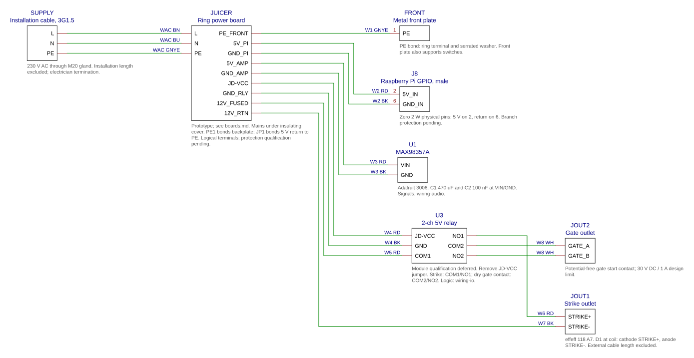
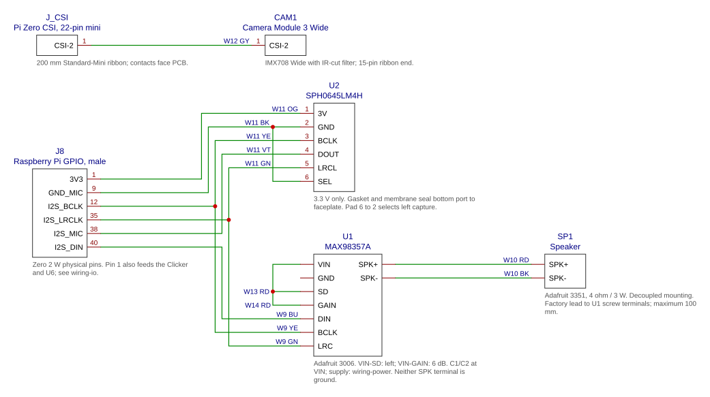
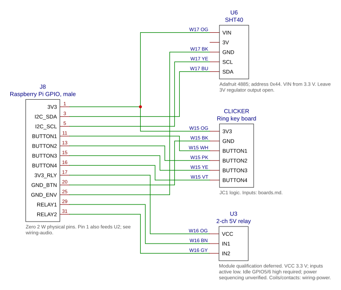

# Ring hardware

Hardware specification for the Raspberry Pi Zero 2 W doorbell with Camera Module 3 Wide, I2S audio, two relays, one to four Kailh BOX buttons, and a sealed outdoor enclosure.

Prototype architecture: the Juicer power board carries two encapsulated mains supplies inside a partitioned compartment; the Clicker key board carries the keys. Electrical and environmental qualification remain open; relay module qualification and antenna keep-out wait for enclosure design.

| Document | Owns |
| --- | --- |
| [Electrical interface](variants/rpi02w_cm3/README.md) | Pin assignments, load budget, device and firmware requirements |
| [Board definitions](boards.md) | Clicker and Juicer circuits, connectors, and PCB targets |
| [Assembly BOM](bom.md) | Parts, quantities, and 300 × 150 mm enclosure harness estimates |

## Wiring

Three drawings show every harness connection; on-board circuits are in the board definitions.

Power and strike, source [wiring-power.yml](wiring-power.yml):



Audio and camera, source [wiring-audio.yml](wiring-audio.yml):



Clicker, relays, and sensor, source [wiring-io.yml](wiring-io.yml):



The sources use the WireViz YAML format. Regenerate the committed SVGs with Bun:

```sh
bun install --cwd scripts/wiring
bun scripts/wiring/render.ts hardware/ring/wiring-power.yml hardware/ring/wiring-audio.yml hardware/ring/wiring-io.yml
```

Use [bom.md](bom.md) for procurement.
